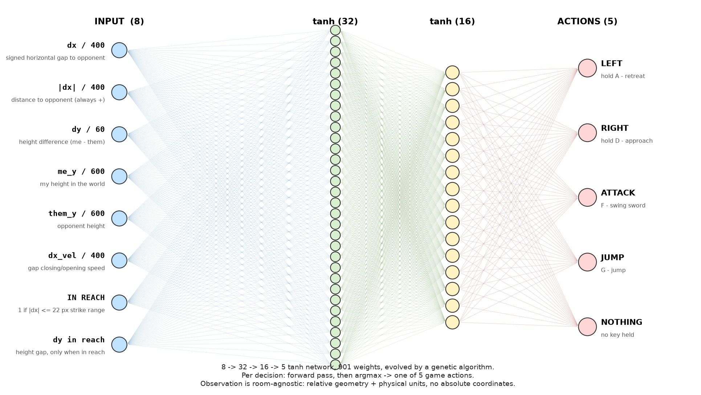

# nidhogg-pau

Train an agent that beats the CPU in **real Nidhogg** (memory reads + key injection — no
simulator, no vision). **This Mac is a git / state / claims mirror only.** The game and all
training run on the Linux farm.

| | |
|---|---|
| **Farm** | `pippi`: `~/nf-p/pau86` (farm root) + `~/nf-p/code_pau` (code) + `~/nf-p/venv` |
| **Status now** | `state/mail/mission_status.txt` |
| **Work list** | newest `## Critic plan` in `state/mail/engineer.md` |
| **Integrity** | No real training (>1 gen) until I1–I4 claims hold. PLAN15 = 1-gen diagnostic only. |

VNC (view-only): `ssh -L 5900:localhost:5988 pippi` → connect viewer to `localhost:5900`
(display `:88` on the farm).

> **Superseded:** the Mac `uv venv` / `python3 train_win.py` / Steam-on-Mac runbook below is
> historical. Do **not** launch the game or train on this Mac. See `AGENTS.md`,
> `LIMITATIONS.md`, and `docs/REPO_SCORE.md`.

---

## The policy network



Mermaid version: [`docs/nn_diagram.md`](docs/nn_diagram.md). Generated from `neuro.py` by
`tools/nn_diagram.py` (PNG/SVG) and `tools/nn_mermaid.py` (Mermaid).

## How it works (farm)

```
┌────────────────────────┐         ┌───────────────────────────┐
│ Nidhogg (Linux / proot)│         │ Python trainer (code_pau) │
│  nidlinux + state spy  │──state──▶  train_win.py / neuro.py  │
│  key injection         │◀─keys────  fitness → GA             │
└────────────────────────┘  /tmp     └───────────────────────────┘
```

State and commands are plain files in `/tmp` on the farm (`nid_state_<id>.txt`,
`nid_keys_<id>.txt`, `nid_insts_<id>.txt`, …). Durable bridge:
`code_pau/tools/nid_state_bridge.py`.

| File | Role |
|---|---|
| `train_state.py` | Launch, enter Training match, read state, send keys |
| `neuro.py` | 8→32→16→7 network (tanh), GA, seed policies |
| `train_win.py` | Episode loop, reward, generational training |
| `evaluate.py` | Win-rate measurement |
| `NOTES.md` | Lab notebook (incl. 2026-11-26 Linux/integrity) |
| `docs/REPO_QUALITY.md` / `REPO_SCORE.md` | Critic-owned quality bar |

## Design decisions worth knowing

* **Memory, not vision.** Fighter x/y from process memory; exact, no permissions theatre.
* **Training menu, not `room_goto`.** Direct room jumps yield an inert CPU; menu path yields a live opponent.
* **I1 fighter identity is currently red.** PLAN15 p2 logs show me/them swapping and me==them samples — every me_x fitness is suspect until the dose-response claim holds.
* **Mac rewrite of train_state/train_win is blocked** until stash-or-keep is decided (farm diffs live on pippi).

## Repo layout

```
docs/          STATE, EXPERIMENTS, REPO_QUALITY/SCORE
state/mail/    mission_status, engineer.md (Critic plan), briefs
tools/         claim.py, plan.py, doctor, farm helpers
NOTES.md       chronological notebook
legacy/        abandoned approaches
```

## Historical Mac runbook (do not use)

<details>
<summary>Old Mac Steam / inject.dylib launch (superseded 2026-11)</summary>

```bash
# DO NOT RUN ON THIS MAC — farm only
uv venv .venv && source .venv/bin/activate
python3 train_win.py --instances 1 --gens 60 --pop 10 --window 60
```

Requirements that applied to the Mac era: Steam Nidhogg, muted via prefs only, at most two
game processes, window parking. All of that is farm ops now — see `AGENTS.md`.

</details>
