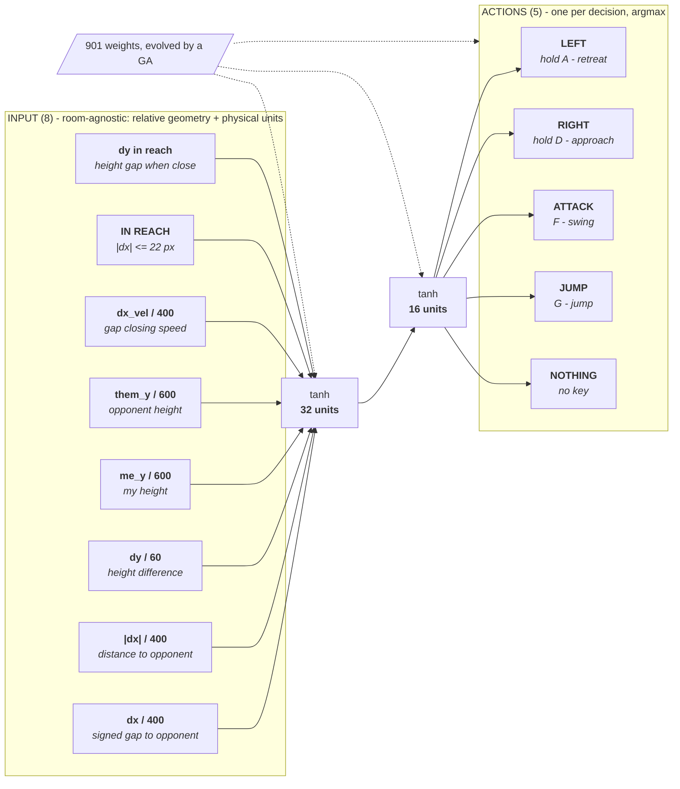

# Policy network

Layers: `[8, 32, 16, 5]` - 901 weights, 5 actions `[65, 68, 70, 71, 0]`.

Generated from `neuro.py` by `tools/nn_mermaid.py`.

## Why each input looks the way it does

* every input is a **relative quantity** or a **physical unit** (pixels / 600 for a
  height), never an absolute coordinate divided by an arbitrary constant - the previous
  version carried `(470 - me_x)/470` where 470 was one arena's width, and it went
  **negative** in wider rooms;
* there is deliberately **no 'distance to my goal' input**: the goal position per room is
  unknown (the decompiled table gives room names, not geometry), and a wrong
  normalisation is worse than none. Direction toward the goal is carried by the reward's
  territory terms instead.
* only five outputs because a keysweep proved `W` and `S` change nothing on this build
  (jump is `G`), so the original seven-action space had two dead keys.
